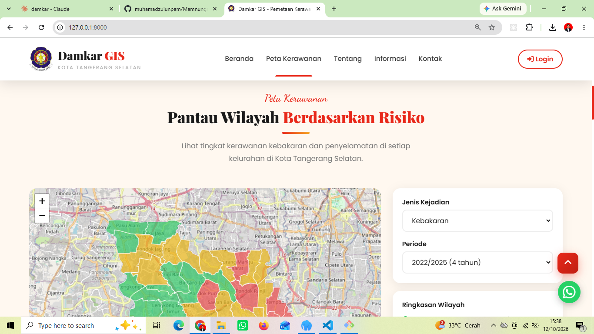
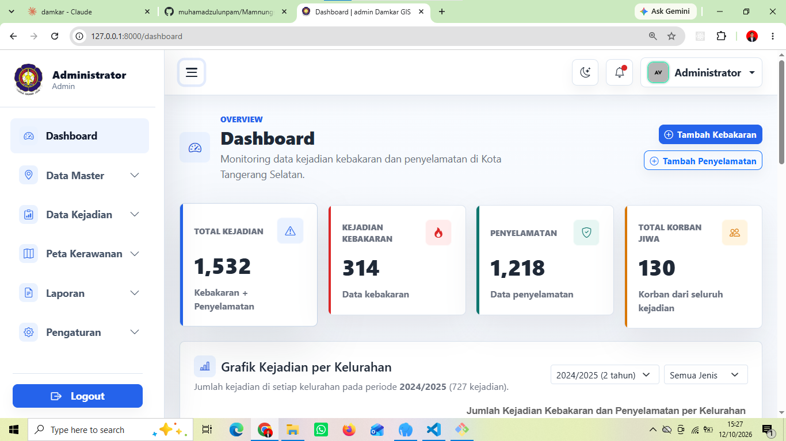
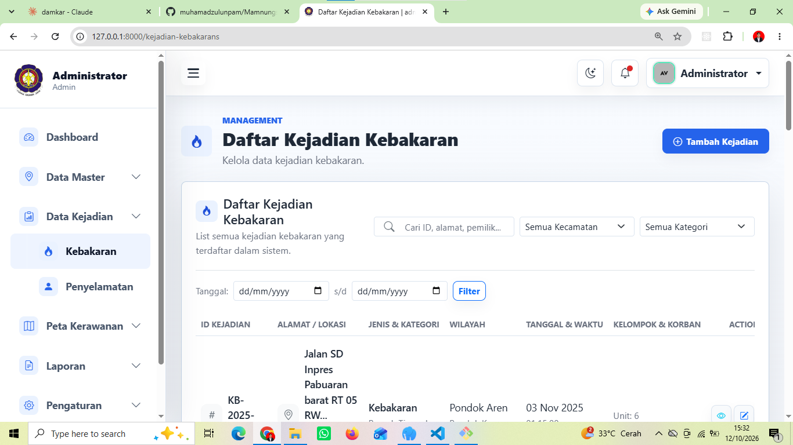
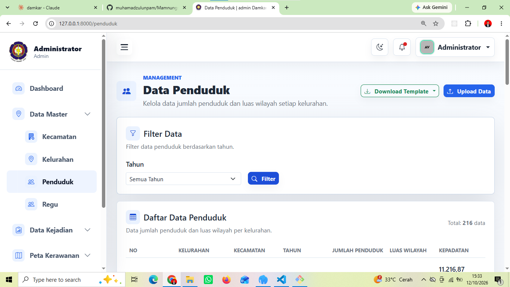
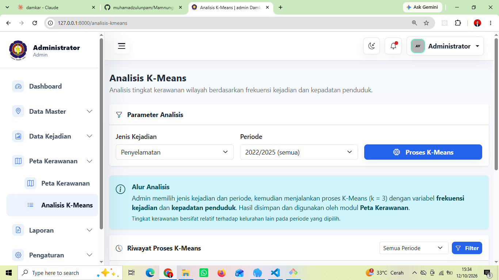
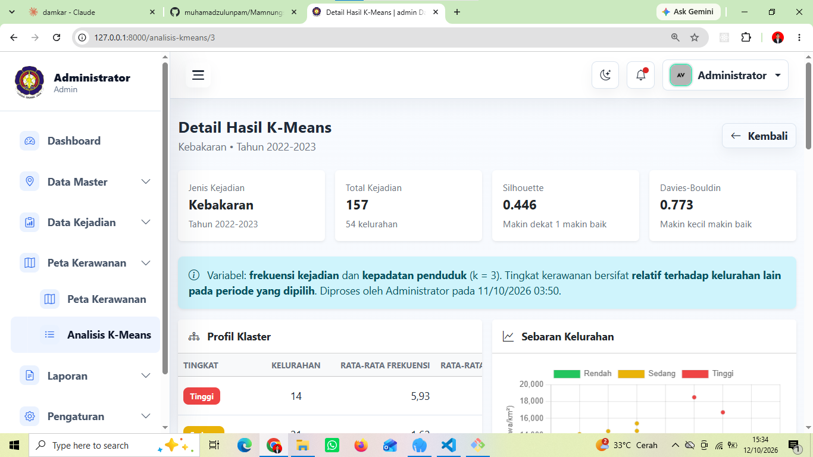
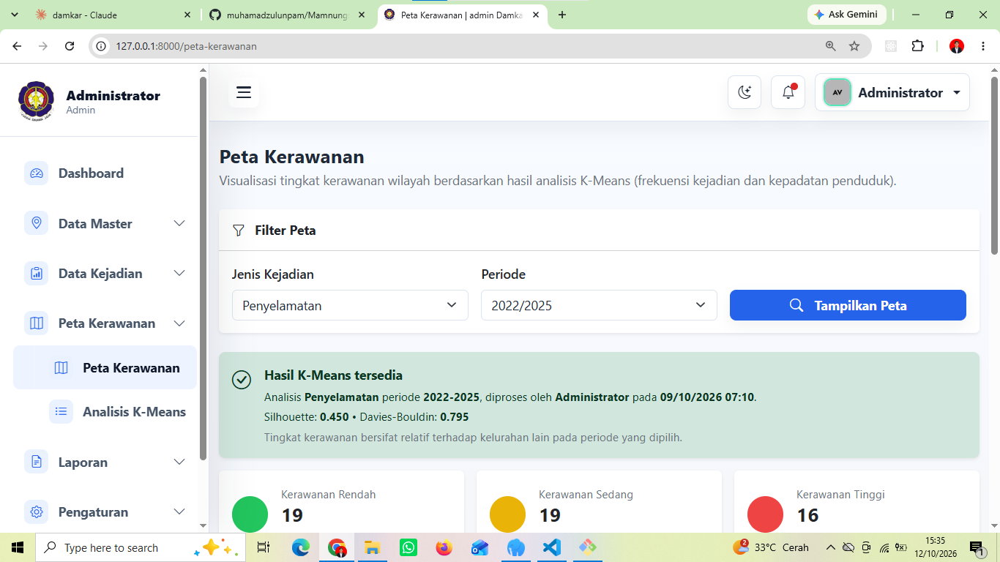
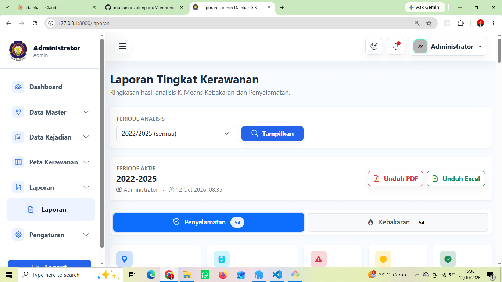
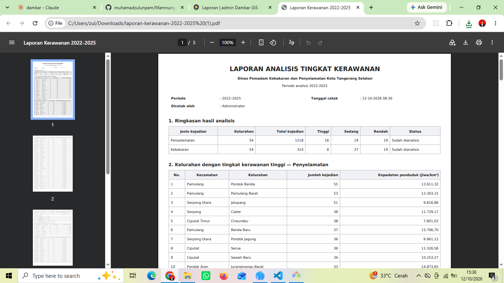

# Damkar GIS — Sistem Informasi Geografis Pemadam Kebakaran

Aplikasi Sistem Informasi Geografis (GIS) untuk mendukung pengelolaan data kejadian kebakaran dan penyelamatan serta analisis tingkat kerawanan wilayah di Kota Tangerang Selatan.

Proyek ini dikembangkan menggunakan **Laravel** dengan integrasi pemetaan wilayah dan algoritma **K-Means Clustering** untuk mengelompokkan tingkat kerawanan kelurahan menjadi tiga kategori: **Tinggi, Sedang, dan Rendah**.

## Daftar Isi

- [Tentang Proyek](#tentang-proyek)
- [Tangkapan Layar](#tangkapan-layar)
- [Fitur Utama](#fitur-utama)
- [Alur Penggunaan](#alur-penggunaan)
- [Metode Analisis](#metode-analisis)
- [Hak Akses Pengguna](#hak-akses-pengguna)
- [Teknologi yang Digunakan](#teknologi-yang-digunakan)
- [Persyaratan Sistem](#persyaratan-sistem)
- [Instalasi dan Menjalankan Aplikasi](#instalasi-dan-menjalankan-aplikasi)
- [Data Penduduk (Template Excel)](#data-penduduk-template-excel)
- [Laporan dan Visualisasi](#laporan-dan-visualisasi)
- [Pemecahan Masalah](#pemecahan-masalah)
- [Keamanan](#keamanan)
- [Tujuan Pengembangan](#tujuan-pengembangan)
- [Developer](#developer)

## Tentang Proyek

Damkar GIS dirancang untuk membantu pengelolaan informasi kejadian kebakaran dan penyelamatan, memvisualisasikan persebaran kejadian berdasarkan wilayah, serta menyajikan hasil analisis kerawanan dalam bentuk yang lebih mudah dipahami.

Sistem ini juga menyediakan pengelolaan data berdasarkan peran pengguna dan laporan analisis berdasarkan periode yang dipilih.

## Tangkapan Layar

### Halaman Utama

Halaman Utama ini merupakan halaman yang akan diakses oleh masyarakat, agar mengetahui informasi update data kejadian yang berada di tangerang selatan.


### Peta Kerawanan Masyarakat

Peta yang kami tampilkan di halaman utama ini, untuk mempermudah masyarakat melihat secara geografis nya.



### Dashboard

Ringkasan data kejadian dan grafik jumlah kejadian per kelurahan berdasarkan periode.



### Data Kejadian

Pengelolaan data kejadian kebakaran dan penyelamatan.



### Data Penduduk

Unduh template Excel per tahun, isi, lalu unggah kembali.



### Analisis K-Means

Pilih jenis kejadian dan periode, lalu jalankan proses K-Means. Riwayat proses tersimpan beserta nilai Silhouette dan Davies-Bouldin.



### Detail Hasil K-Means

Profil klaster, sebaran kelurahan, dan tabel hasil per kelurahan.



### Peta Kerawanan

Visualisasi tingkat kerawanan per kelurahan pada peta.



### Laporan

Pratinjau laporan dan tombol unduh PDF serta Excel.



### Contoh Laporan PDF



## Fitur Utama

- **Dashboard** — Ringkasan kejadian dan grafik jumlah kejadian per kelurahan, dapat difilter berdasarkan periode dan jenis kejadian.
- **Manajemen Pengguna** — Mengelola akun dan hak akses pengguna.
- **Manajemen Wilayah** — Mengelola data kecamatan dan kelurahan.
- **Manajemen Jenis Kejadian** — Mengelola kategori kejadian kebakaran dan penyelamatan.
- **Manajemen Kejadian** — Mengelola data kejadian kebakaran dan penyelamatan.
- **Data Penduduk** — Mengelola jumlah penduduk dan luas wilayah per kelurahan melalui template Excel (unduh, isi, unggah) dengan validasi per baris.
- **Analisis K-Means** — Mengelompokkan kelurahan ke dalam kategori kerawanan Tinggi, Sedang, dan Rendah, lengkap dengan nilai Silhouette dan Davies-Bouldin.
- **Peta Kerawanan** — Memvisualisasikan tingkat kerawanan berdasarkan wilayah geografis.
- **Laporan Analisis** — Menampilkan ringkasan hasil analisis berdasarkan periode yang dipilih.
- **Ekspor Laporan** — Mengunduh laporan dalam format PDF dan Excel.
- **Activity Log** — Mencatat aktivitas pengguna untuk membantu penelusuran aktivitas sistem.

## Alur Penggunaan

1. **Siapkan data wilayah** — Pastikan data kecamatan dan kelurahan tersedia.
2. **Input data kejadian** — Tambahkan data kejadian kebakaran dan penyelamatan.
3. **Lengkapi Data Penduduk** — Unduh template Excel per tahun, isi jumlah penduduk dan luas wilayah, lalu unggah.
4. **Jalankan Analisis K-Means** — Pilih jenis kejadian (Penyelamatan atau Kebakaran) dan periode, lalu proses. Ulangi untuk setiap jenis dan periode yang dibutuhkan.
5. **Lihat Peta Kerawanan** — Pilih jenis dan periode untuk melihat hasil pada peta.
6. **Unduh Laporan** — Pilih periode pada menu Laporan, lalu unduh PDF atau Excel.

Periode analisis yang tersedia mengikuti tahun pada Data Penduduk, misalnya `2022/2023`, `2023/2024`, `2024/2025`, dan `2022/2025` (seluruh periode).

## Metode Analisis

Aplikasi menggunakan algoritma **K-Means Clustering** untuk mengelompokkan kelurahan berdasarkan dua variabel:

| Variabel | Keterangan |
|---|---|
| Frekuensi kejadian | Jumlah kejadian di kelurahan pada periode yang dipilih |
| Kepadatan penduduk | Rata-rata jumlah penduduk pada periode ÷ luas wilayah (jiwa/km²) |

**Tahapan perhitungan:**

1. **Pengumpulan data** — Frekuensi kejadian dihitung terpisah untuk kejadian Penyelamatan dan Kebakaran.
2. **Normalisasi Min-Max** — Kedua variabel diubah ke skala 0 sampai 1 agar variabel berskala besar tidak mendominasi jarak Euclidean.

   ```text
   x' = (x - x_min) / (x_max - x_min)
   ```

3. **K-Means dengan k = 3** — Inisialisasi K-Means++ diulang 50 kali dan diambil hasil dengan inertia terkecil.
4. **Pelabelan** — Klaster diurutkan berdasarkan rata-rata nilai pusat klaster: terendah menjadi Rendah, tengah menjadi Sedang, tertinggi menjadi Tinggi.
5. **Evaluasi** — Kualitas hasil diukur dengan Silhouette Score (makin dekat 1 makin baik) dan Davies-Bouldin Index (makin kecil makin baik).

Hasil pengelompokan disajikan dalam tiga tingkat kerawanan:

| Kategori | Keterangan |
|---|---|
| Tinggi | Kelurahan yang masuk ke kelompok kerawanan tinggi |
| Sedang | Kelurahan yang masuk ke kelompok kerawanan sedang |
| Rendah | Kelurahan yang masuk ke kelompok kerawanan rendah |

Hasil analisis digunakan untuk mendukung visualisasi peta kerawanan dan penyusunan laporan.

> **Catatan:** Tingkat kerawanan merupakan hasil pengelompokan **relatif terhadap kelurahan lain pada periode yang dianalisis**, bukan prediksi pasti terjadinya kejadian. Satu kelurahan dapat berada pada tingkat berbeda untuk periode yang berbeda. Korban jiwa dan kerugian hanya ditampilkan sebagai informasi pendukung dan bukan variabel input K-Means.

## Hak Akses Pengguna

| Role | Hak Akses Utama |
|---|---|
| Admin | Mengelola pengguna, data master, data kejadian, peta, dan melihat hasil analisis |
| Petugas | Mengelola data kejadian serta melihat informasi wilayah dan peta |
| Pimpinan | Melihat informasi wilayah, peta kerawanan, hasil analisis, dan laporan |

Hak akses mengikuti konfigurasi otorisasi yang diterapkan di dalam aplikasi.

## Teknologi yang Digunakan

- **Backend:** PHP, Laravel
- **Database:** MySQL
- **Frontend:** Blade, HTML, CSS, JavaScript, Bootstrap
- **Peta:** Leaflet dan batas wilayah kelurahan
- **Grafik:** Chart.js
- **Data Mining:** Algoritma K-Means Clustering (implementasi sendiri pada service Laravel)
- **Ekspor Dokumen:** DomPDF (`barryvdh/laravel-dompdf`) dan Laravel Excel (`maatwebsite/excel`)
- **Version Control:** Git dan GitHub

## Persyaratan Sistem

Pastikan perangkat pengembangan sudah memiliki:

- PHP 8.3 atau versi yang kompatibel dengan proyek
- Composer
- MySQL
- Git
- Koneksi internet (aset peta, grafik, dan batas wilayah dimuat dari sumber eksternal)

**Ekstensi PHP yang dibutuhkan:**

| Ekstensi | Kegunaan |
|---|---|
| `zip` | Membaca dan menulis file Excel (.xlsx) |
| `gd` | Dibutuhkan Laravel Excel |
| `fileinfo` | Validasi file unggahan |
| `mbstring` dan `dom` | Pembuatan PDF |
| `pdo_mysql` | Koneksi MySQL |

Versi dependency yang digunakan mengikuti konfigurasi proyek di `composer.json` dan `package.json`.

## Instalasi dan Menjalankan Aplikasi

### 1. Clone repository

```bash
git clone https://github.com/muhamadzulunpam/damkar-gis.git
cd damkar-gis
```

### 2. Install dependency backend

```bash
composer install
```

### 3. Siapkan file environment

Salin file `.env.example` menjadi `.env`.

```bash
cp .env.example .env
```

Pada Windows, kamu juga bisa menyalin file tersebut secara manual melalui File Explorer.

### 4. Buat application key

```bash
php artisan key:generate
```

### 5. Konfigurasi database

Buat database MySQL untuk proyek ini, kemudian sesuaikan konfigurasi berikut di file `.env`:

```env
DB_CONNECTION=mysql
DB_HOST=127.0.0.1
DB_PORT=3306
DB_DATABASE=damkar_gis
DB_USERNAME=root
DB_PASSWORD=
```

Sesuaikan nama database, username, dan password dengan konfigurasi MySQL lokal kamu.

### 6. Jalankan migrasi dan seeder

```bash
php artisan migrate
php artisan db:seed
```

Seeder menyiapkan data awal seperti kecamatan, kelurahan, dan data kejadian. Jalankan sesuai seeder yang tersedia pada proyek.

> **Catatan:** Pastikan database sudah dibuat sebelum menjalankan migrasi. Seeder kejadian membaca data dari file JSON di `database/seeders/data/`, sehingga file tersebut harus ada.

### 7. Install dependency frontend (opsional)

Jalankan langkah ini hanya jika proyek memakai aset yang dibangun dengan Vite.

```bash
npm install
npm run build
```

### 8. Jalankan aplikasi

```bash
php artisan serve
```

Akses aplikasi melalui:

```text
http://127.0.0.1:8000
```

## Data Penduduk (Template Excel)

Data penduduk diinput melalui template Excel per tahun supaya penulisan kelurahan dan tahun tidak salah.

1. Buka menu **Data Penduduk**, pilih tahun pada tombol **Download Template**.
2. Isi kolom **Jumlah Penduduk** dan **Luas Wilayah (km²)**. Kolom lain jangan diubah.
3. Klik **Upload Data**, pilih tahun yang sama dengan template, lalu unggah file.

| Kolom | Diisi oleh | Keterangan |
|---|---|---|
| Kelurahan ID | Sistem | Dipakai untuk mencocokkan data, jangan diubah |
| Kelurahan | Sistem | Hanya untuk dibaca |
| Kecamatan | Sistem | Hanya untuk dibaca |
| Tahun | Sistem | Harus sama dengan tahun yang dipilih saat unggah |
| Jumlah Penduduk | Admin | Angka bulat, tanpa titik pemisah ribuan |
| Luas Wilayah (km²) | Admin | Angka lebih dari 0 |

Seluruh baris divalidasi lebih dulu. Jika ada satu baris yang salah, tidak ada data yang disimpan dan sistem menampilkan pesan kesalahan per baris. Mengunggah ulang tahun yang sama akan memperbarui data yang sudah ada.

## Laporan dan Visualisasi

Hasil analisis K-Means yang telah tersimpan dapat digunakan untuk menampilkan peta kerawanan dan menyusun laporan berdasarkan periode yang dipilih.

Laporan menyediakan ringkasan analisis untuk kejadian kebakaran dan penyelamatan, serta fasilitas ekspor PDF dan Excel. Laporan hanya membaca hasil yang sudah diproses dan tidak menghitung ulang K-Means.

**Isi laporan PDF:**

- Ringkasan jumlah kelurahan Tinggi, Sedang, dan Rendah untuk setiap jenis kejadian.
- Penjelasan singkat metode analisis.
- Profil klaster dan daftar kelurahan berkerawanan Tinggi.
- Tabel lengkap seluruh kelurahan.

**Isi laporan Excel:** satu sheet Ringkasan dan satu sheet detail untuk setiap jenis kejadian yang sudah dianalisis.

## Pemecahan Masalah

| Masalah | Penyebab dan solusi |
|---|---|
| `Class "ZipArchive" not found` | Ekstensi `zip` belum aktif. Aktifkan `extension=zip` di `php.ini`, lalu restart server. |
| "Data penduduk/luas wilayah belum lengkap untuk ..." saat proses K-Means | Kelurahan tersebut belum punya data penduduk, atau luas wilayahnya 0. Lengkapi lewat menu Data Penduduk. |
| Ada kelurahan abu-abu pada peta padahal sudah dianalisis | Nama kelurahan pada data batas wilayah berbeda ejaan dengan di database. Samakan penulisannya. |
| Peta atau grafik tidak tampil | Aset dimuat dari sumber eksternal. Periksa koneksi internet. |
| Periode tidak muncul pada peta atau laporan | Analisis K-Means untuk periode dan jenis tersebut belum dijalankan. |
| `fatal: detected dubious ownership` pada Git (Windows) | Jalankan `git config --global --add safe.directory C:/laragon/www/damkar-gis`. |

## Keamanan

- Jangan mengunggah file `.env` atau kredensial rahasia ke repository publik.
- Gunakan konfigurasi environment untuk menyimpan informasi sensitif.
- Terapkan hak akses sesuai role pengguna.
- Gunakan data yang sesuai dan valid saat melakukan analisis.

## Tujuan Pengembangan

Proyek ini dikembangkan sebagai implementasi pengembangan aplikasi web yang menggabungkan:

- Pengelolaan data operasional.
- Integrasi informasi geografis.
- Penerapan algoritma data mining.
- Visualisasi data untuk mendukung pengambilan keputusan.
- Pembuatan laporan yang dapat digunakan sebagai dokumentasi analisis.

## Developer

**Muhamad Zul Sa'ban**

Web Developer | Programmer

- GitHub: [@muhamadzulunpam](https://github.com/muhamadzulunpam)

---

Damkar GIS — Sistem Informasi Geografis untuk mendukung analisis kerawanan kebakaran dan penyelamatan di Kota Tangerang Selatan.